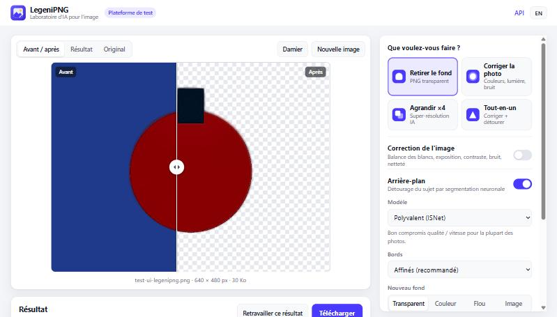
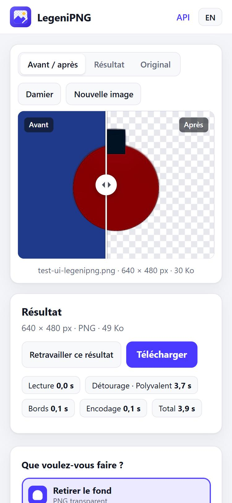
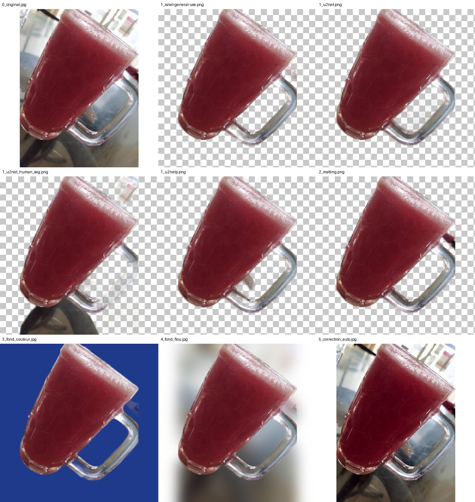
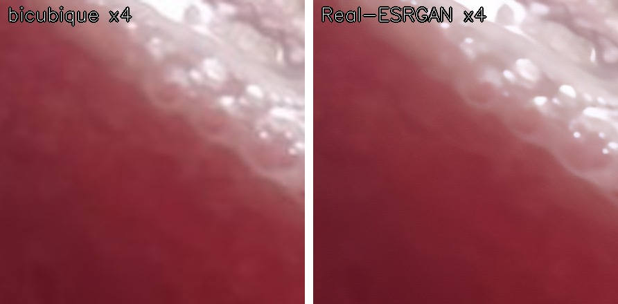
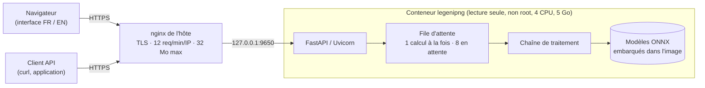
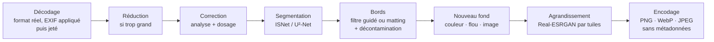

# LegeniPNG — laboratoire d'IA pour l'image


Plateforme de test de **Legeni Consulting** pour le traitement d'image par intelligence artificielle :
**retrait d'arrière-plan**, **correction automatique des photos** et **agrandissement par IA**, avec une
interface web bilingue (français / anglais) et une API HTTP. Tout tourne **sur processeur, sans GPU**.

**En ligne : <https://legenipng.legeniconsulting.cm>** · documentation interactive de l'API :
<https://legenipng.legeniconsulting.cm/api/docs>



---

## Sommaire

1. [Fonctionnalités](#fonctionnalités)
2. [Technologies](#technologies)
3. [Modèles d'IA](#modèles-dia)
4. [Architecture](#architecture)
5. [Structure du dépôt](#structure-du-dépôt)
6. [Déploiement](#déploiement)
7. [Configuration](#configuration)
8. [API](#api)
9. [Tests](#tests)
10. [Performances](#performances)
11. [Sécurité et confidentialité](#sécurité-et-confidentialité)
12. [Dépannage](#dépannage)
13. [Limites et feuille de route](#limites-et-feuille-de-route)

---

## Fonctionnalités

| Traitement | Ce qu'il fait |
|---|---|
| **Retrait d'arrière-plan** | Segmentation neuronale du sujet (4 modèles au choix), puis affinage des bords par filtre guidé et suppression du liseré de l'ancien fond. Option *matting* pour les cheveux et la fourrure. |
| **Nouveau fond** | Transparent, couleur unie, flou « mode portrait » (sans bavure du sujet dans le flou) ou image fournie (recadrée pour couvrir). |
| **Correction** | Analyse de l'image (dominante de couleur, exposition, bruit, netteté, saturation) puis correction dosée automatiquement — ou réglage manuel de 7 curseurs : balance des blancs, niveaux, exposition, contraste local, débruitage, netteté, vibrance. |
| **Agrandissement IA ×2 / ×4** | Super-résolution par réseau génératif antagoniste (Real-ESRGAN) : reconstruit les détails au lieu d'étirer les pixels, avec 3 niveaux de débruitage. |

Les traitements se combinent en un seul passage (ex. « corriger + détourer + agrandir »). L'interface propose
4 préréglages, un comparateur avant / après glissant, l'aperçu sur damier / fond sombre / fond clair, le
collage depuis le presse-papiers, la reprise d'un résultat comme nouvelle source, et l'export PNG, WebP ou JPEG.
Les photos HEIC des iPhone sont acceptées.

<p align="center"></p>

| Original, 4 modèles de détourage, matting, fond couleur, fond flou, correction auto | Agrandissement ×4 : bicubique contre Real-ESRGAN |
|---|---|
|  |  |

---

## Technologies

| Couche | Technologie | Version | Rôle |
|---|---|---|---|
| Langage | **Python** | 3.12 | Tout le service |
| API web | **FastAPI** + Starlette | 0.143 / 1.8 | Routes, validation des formulaires, documentation OpenAPI |
| Serveur d'application | **Uvicorn** (uvloop, httptools) | 0.54 | Serveur ASGI, un seul processus (modèles chargés une fois) |
| Inférence IA | **ONNX Runtime** (CPU) | 1.31 | Exécution des réseaux de neurones, sans PyTorch en production |
| Détourage | **rembg** | 2.0.85 | Sessions de segmentation ISNet / U²-Net |
| Matting | **PyMatting** + **Numba** | 1.1.16 / 0.68 | Matting fermé des bords fins, compilé en code natif |
| Vision | **OpenCV** (headless) | 4.14 | Correction, filtre guidé, compositions, redimensionnements |
| Calcul | **NumPy** | 2.5 | Tableaux d'images |
| Images | **Pillow** + **pillow-heif** | 12.3 / 1.8 | Décodage sûr (JPEG, PNG, WebP, HEIC, AVIF, TIFF…), encodage sans métadonnées |
| Export du modèle d'agrandissement | **PyTorch** + **ONNX** | 2.5.1 / 1.17 | Étape de construction jetable uniquement |
| Interface | **HTML / CSS / JavaScript** natifs | — | Aucun framework ni dépendance externe ; bilingue FR / EN ; thème clair / sombre |
| Conteneur | **Docker** + **Docker Compose** | 29 / v5 | Image multi-étapes, conteneur durci |
| Frontal | **nginx** | 1.24 | Terminaison TLS, limitation de cadence, taille des envois |
| Certificats | **Let's Encrypt** (certbot, webroot) | 2.9 | HTTPS, renouvellement automatique |
| Système hôte | **Ubuntu** | 24.04 LTS | VPS 8 vCPU / 23 Go, sans GPU |

Les versions exactes de toutes les dépendances Python sont figées dans [`requirements.lock`](requirements.lock).

---

## Modèles d'IA

| Modèle | Usage | Entrée réseau | Poids | Licence |
|---|---|---|---|---|
| **ISNet general-use** (DIS) | Détourage polyvalent — **par défaut** | 1024 × 1024 | 179 Mo | Apache 2.0 |
| **U²-Net** | Détourage, second avis (objets, animaux) | 320 × 320 | 176 Mo | Apache 2.0 |
| **U²-Net human seg** | Détourage de personnes | 320 × 320 | 176 Mo | Apache 2.0 |
| **U²-Net-p** | Détourage rapide | 320 × 320 | 4,7 Mo | Apache 2.0 |
| **Real-ESRGAN general x4v3** (+ variante *wdn*) | Agrandissement ×4 | dynamique (tuiles 256 px) | 3 × 4,9 Mo | BSD-3-Clause |

Tous ces modèles autorisent un usage commercial. Deux modèles ont été **écartés volontairement** :

- **BRIA RMBG** (modèle par défaut de rembg 2.0.85) : licence **non commerciale**.
- **BiRefNet** : entrée figée à 1024 × 1024 et **plus de 5 Go de RAM** sur CPU — le conteneur était tué par
  manque de mémoire dès la première image.

Le niveau de débruitage de l'agrandissement est obtenu comme dans Real-ESRGAN, par interpolation des poids
(*deep network interpolation*) entre `x4v3` (débruite fort) et `wdn-x4v3` (garde le grain) : trois modèles ONNX
sont exportés à 0 %, 50 % et 100 % (`low`, `medium`, `high`).

---

## Architecture



**Chaîne de traitement** (`app/pipeline.py`), chaque étape étant facultative :



Choix de conception :

- **Un seul processus Uvicorn** : chaque modèle n'est chargé qu'une fois en mémoire. Les calculs passent par
  une file bornée (`JobGate`) exécutée dans un fil de travail, pour ne pas bloquer la boucle asynchrone ; au-delà
  de la file, la réponse est un 503 « plateforme occupée » plutôt qu'un empilement sans fin.
- **Aucun stockage** : l'image arrive, est traitée en mémoire et repart dans la réponse. Le compte rendu
  (étapes, durées, analyse, avertissements) voyage dans l'en-tête `X-Legenipng-Report`.
- **PyTorch absent de la production** : il ne sert qu'à exporter Real-ESRGAN en ONNX dans une étape de
  construction jetable ; l'image finale n'embarque qu'ONNX Runtime.
- **Agrandissement par tuiles** de 256 px avec 16 px de recouvrement : mémoire bornée quelle que soit l'image.
- **Couleurs des bords décontaminées** par convolution normalisée : le sujet détouré ne garde pas de liseré de
  l'ancien fond quand on le pose sur un nouveau.

---

## Structure du dépôt

```text
legenipng/
├── app/
│   ├── main.py            # API FastAPI : routes, validation, file d'attente, en-têtes de sécurité
│   ├── pipeline.py        # enchaînement des traitements et compte rendu
│   ├── imaging.py         # décodage sûr (format réel, bombes de décompression) et encodage
│   ├── enhance.py         # analyse et correction d'image (OpenCV)
│   ├── background.py      # détourage rembg, filtre guidé, matting, décontamination, fonds
│   ├── superres.py        # Real-ESRGAN ONNX par tuiles
│   ├── config.py          # paramètres (surchargeables par variables d'environnement)
│   └── static/            # interface web : index.html, app.js, style.css, logo.svg
├── tools/
│   ├── export_realesrgan.py   # export PyTorch -> ONNX (étape de construction)
│   ├── fetch_models.py        # téléchargement des modèles rembg (étape de construction)
│   └── warm_numba.py          # précompilation du cache Numba (étape de construction)
├── deploy/
│   ├── nginx-legenipng.conf             # vhost de production (HTTPS)
│   └── nginx-legenipng-bootstrap.conf   # vhost provisoire pour obtenir le certificat
├── tests/
│   ├── test_api.sh        # recette de bout en bout (25 contrôles)
│   └── report_summary.py
├── docs/                  # captures et planches de recette
├── Dockerfile             # construction multi-étapes
├── docker-compose.yml     # conteneur durci, port en boucle locale
├── requirements.txt       # dépendances directes (plages de versions)
└── requirements.lock      # versions exactes installées dans l'image
```

---

## Déploiement

### Mode de déploiement

LegeniPNG se déploie en **un conteneur Docker unique**, construit **sur le serveur cible** à partir de ce dépôt
et lancé par **Docker Compose**. Le conteneur n'écoute qu'en **boucle locale** (`127.0.0.1:9650`) ; c'est le
**nginx de l'hôte** qui l'expose en **HTTPS** avec un certificat **Let's Encrypt**. Aucune base de données,
aucun volume persistant, aucun secret : le service est entièrement sans état.

### Construction de l'image (multi-étapes)

| Étape | Base | Contenu | Conservée ? |
|---|---|---|---|
| `sr-export` | `python:3.12-slim-bookworm` | PyTorch CPU + ONNX ; télécharge les poids officiels Real-ESRGAN (GitHub `xinntao/Real-ESRGAN`, v0.2.5.0), les interpole et les exporte en 3 modèles ONNX vérifiés par `onnx.checker` | **Non** (jetable) |
| finale | `python:3.12-slim-bookworm` | Dépendances de `requirements.lock`, modèles rembg téléchargés (557 Mo), modèles ONNX copiés depuis `sr-export`, cache Numba précompilé, code de l'application, utilisateur `app` non root | Oui (≈ 3,4 Go) |

Tous les modèles sont **intégrés à l'image** : le conteneur démarre sans accès réseau et sur un système de
fichiers en lecture seule. Première construction : 10 à 15 minutes (téléchargements) ; les suivantes réutilisent
le cache et ne reconstruisent que les couches modifiées.

### Prérequis

- Linux x86-64 avec Docker ≥ 24 et le greffon Docker Compose v2.
- **4 vCPU et 5 Go de RAM disponibles** pour le conteneur (pic mesuré : 2,5 Go), ~10 Go de disque pour
  l'image et le cache de construction.
- Accès sortant à PyPI, `download.pytorch.org` et GitHub **pendant la construction uniquement**.
- nginx et certbot sur l'hôte, un enregistrement DNS pointant vers le serveur.

### Installation pas à pas

```bash
# 1. Récupérer le code
git clone https://github.com/Legeni07/legenipng.git /opt/legenipng
cd /opt/legenipng

# 2. Construire et démarrer le conteneur
docker compose build
docker compose up -d

# 3. Attendre « warm »: true (≈ 25 s : chargement du modèle par défaut et auto-test de l'agrandissement)
curl -s http://127.0.0.1:9650/api/health

# 4. Vhost provisoire pour le défi ACME, puis certificat
cp deploy/nginx-legenipng-bootstrap.conf /etc/nginx/sites-available/legenipng.legeniconsulting.cm
ln -s /etc/nginx/sites-available/legenipng.legeniconsulting.cm /etc/nginx/sites-enabled/
nginx -t && systemctl reload nginx
certbot certonly --webroot -w /var/www/certbot -d legenipng.legeniconsulting.cm

# 5. Vhost définitif (HTTPS, limitation de cadence, délais longs pour le calcul)
cp deploy/nginx-legenipng.conf /etc/nginx/sites-available/legenipng.legeniconsulting.cm
nginx -t && systemctl reload nginx

# 6. Recette complète, à travers nginx
bash tests/test_api.sh photo.jpg fond.jpg https://legenipng.legeniconsulting.cm
```

Pour un autre nom de domaine, remplacer `legenipng.legeniconsulting.cm` dans les deux fichiers de `deploy/`.

### Durcissement du conteneur (`docker-compose.yml`)

| Mesure | Valeur |
|---|---|
| Publication | `127.0.0.1:9650` uniquement — jamais exposé directement sur Internet |
| Utilisateur | `app` (non root) |
| Système de fichiers | lecture seule ; `/tmp` en tmpfs de 1 Go |
| Capacités Linux | toutes retirées (`cap_drop: ALL`), `no-new-privileges` |
| Ressources | 4 CPU, 5 Go de RAM, 256 processus |
| Journaux | rotation 3 × 10 Mo |
| Santé | `HEALTHCHECK` sur `/api/health` |
| Réseau | `network_mode: bridge` (aucun sous-réseau dédié : les plages Docker de l'hôte sont épuisées) |

### Mettre à jour

```bash
cd /opt/legenipng
docker tag legenipng:latest legenipng:prev     # point de retour
git pull
docker compose build && docker compose up -d
bash tests/test_api.sh photo.jpg fond.jpg

# retour arrière si besoin
docker tag legenipng:prev legenipng:latest && docker compose up -d --no-build
```

### Mettre à jour les dépendances

`requirements.txt` donne les plages acceptées, `requirements.lock` les versions exactes réellement installées.
Pour monter de version : installer depuis `requirements.txt` dans une construction d'essai, passer la recette,
puis régénérer le verrou depuis le conteneur :

```bash
docker run --rm legenipng:latest pip freeze > requirements.lock
```

### Déploiement de production actuel

| Élément | Valeur |
|---|---|
| Serveur | VPS Ubuntu 24.04, 8 vCPU / 23 Go, sans GPU, mutualisé avec d'autres services |
| Dossier | `/opt/legenipng` |
| Conteneur / image | `legenipng` / `legenipng:latest` |
| Port | `127.0.0.1:9650` |
| Vhost nginx | `/etc/nginx/sites-available/legenipng.legeniconsulting.cm` (lien dans `sites-enabled`) |
| Certificat | `/etc/letsencrypt/live/legenipng.legeniconsulting.cm/`, renouvelé par `certbot.timer` |
| DNS | enregistrement joker `*.legeniconsulting.cm` |

---

## Configuration

Variables d'environnement lues par `app/config.py` (à poser dans `docker-compose.yml`) :

| Variable | Défaut | Rôle |
|---|---|---|
| `LEGENIPNG_MAX_UPLOAD_MB` | `15` | Poids maximal d'un fichier envoyé |
| `LEGENIPNG_MAX_DECODE_PIXELS` | `50000000` | Garde-fou contre les bombes de décompression |
| `LEGENIPNG_MAX_SIDE` | `3000` | Côté maximal traité ; au-delà, réduction signalée dans le compte rendu |
| `LEGENIPNG_MATTING_MAX_SIDE` | `2048` | Côté maximal pour le matting des bords |
| `LEGENIPNG_SR_MAX_SIDE_X2` | `1200` | Entrée maximale de l'agrandissement ×2 |
| `LEGENIPNG_SR_MAX_SIDE_X4` | `720` | Entrée maximale de l'agrandissement ×4 |
| `LEGENIPNG_SR_TILE` | `256` | Taille des tuiles de l'agrandissement |
| `LEGENIPNG_MAX_JOBS` | `1` | Calculs simultanés |
| `LEGENIPNG_QUEUE_MAX` | `8` | Requêtes en attente avant refus (503) |
| `LEGENIPNG_THREADS` / `OMP_NUM_THREADS` | `4` | Fils de calcul ONNX Runtime et OpenCV |
| `LEGENIPNG_MAX_BG_SESSIONS` | `2` | Modèles de détourage gardés en mémoire simultanément |
| `ORT_DISABLE_TELEMETRY` | `1` | Coupe la télémétrie Microsoft d'ONNX Runtime (posé dans l'image) |

nginx limite en outre `/api/process` à **12 requêtes par minute et par IP** (rafale de 6, réponse 429) et le
corps des requêtes à 32 Mo (image + image de fond).

---

## API

| Méthode | Chemin | Rôle |
|---|---|---|
| `POST` | `/api/process` | Traite une image et renvoie le résultat (corps binaire) |
| `GET` | `/api/config` | Modèles disponibles, limites, niveaux d'agrandissement |
| `GET` | `/api/health` | État : modèles préchargés, agrandissement prêt, file d'attente |
| `GET` | `/api/docs` | Documentation interactive (Swagger) |

### `POST /api/process` (multipart/form-data)

| Champ | Valeurs | Défaut |
|---|---|---|
| `image` | fichier (JPEG, PNG, WebP, HEIC, AVIF, TIFF, BMP, GIF) | **obligatoire** |
| `enhance_mode` | `off` · `auto` · `manual` | `off` |
| `wb`, `levels`, `exposure`, `local_contrast`, `denoise`, `sharpen`, `vibrance` | 0 à 100 (mode `manual`) | `0` |
| `remove_bg` | `true` · `false` | `false` |
| `model` | `isnet-general-use` · `u2net` · `u2net_human_seg` · `u2netp` | `isnet-general-use` |
| `edges` | `standard` · `refined` · `matting` | `refined` |
| `bg_mode` | `transparent` · `color` · `blur` · `image` | `transparent` |
| `bg_color` | `#rrggbb` | `#ffffff` |
| `bg_blur` | 0 à 100 | `50` |
| `background_image` | fichier (si `bg_mode=image`) | — |
| `upscale` | `1` · `2` · `4` | `1` |
| `sr_denoise` | `low` · `medium` · `high` | `medium` |
| `output_format` | `png` · `webp` · `jpg` | `png` |

```bash
# Détourage sur fond blanc, en JPEG
curl -F image=@produit.jpg -F remove_bg=true -F bg_mode=color -F bg_color=#ffffff \
     -F output_format=jpg -o produit-fond-blanc.jpg \
     https://legenipng.legeniconsulting.cm/api/process

# Correction automatique puis agrandissement ×2
curl -F image=@photo.jpg -F enhance_mode=auto -F upscale=2 -F output_format=jpg \
     -o photo-corrigee.jpg https://legenipng.legeniconsulting.cm/api/process
```

Compte rendu renvoyé dans l'en-tête `X-Legenipng-Report` :

```json
{
  "version": "1.0.0",
  "input":  {"format": "JPEG", "width": 800, "height": 800},
  "output": {"format": "png", "width": 800, "height": 800, "bytes": 527360, "transparent": true},
  "steps": [
    {"step": "decode", "ms": 7, "format": "JPEG"},
    {"step": "segment", "ms": 2593, "model": "isnet-general-use"},
    {"step": "edges", "ms": 250, "mode": "refined", "coverage": 0.412},
    {"step": "encode", "ms": 226, "format": "png"}
  ],
  "notes": [],
  "total_ms": 3076
}
```

Erreurs : corps JSON `{"code": "...", "detail": "message en français"}` — `bad_image` / `unsupported_format`
(415), `too_large` / `too_many_pixels` (413), `bad_option` / `missing_background` (400), `busy` /
`upscale_unavailable` (503), `internal` (500). nginx peut renvoyer 429 (cadence) ou 413 (corps > 32 Mo).

---

## Tests

`tests/test_api.sh` exerce le service de bout en bout et affiche, pour chaque cas, le code HTTP, la durée,
les dimensions produites et le temps de chaque étape :

```bash
bash tests/test_api.sh <photo.jpg> [<fond.jpg>] [URL]   # URL par défaut : http://127.0.0.1:9650
```

Les photos de test ne sont pas versionnées : n'importe quelle photo JPEG convient.

25 contrôles : santé et configuration, chacun des 4 modèles, bords bruts / affinés / matting, les 3 types de
fond, correction automatique et manuelle, agrandissement ×2 et ×4, traitement combiné, 7 cas d'erreur attendus
(fichier non-image, modèle inconnu, valeur hors bornes, couleur invalide, facteur interdit, fond manquant,
fichier trop lourd) et **l'absence d'EXIF dans les résultats**. Dernier passage : 25 / 25, en local comme à
travers nginx en HTTPS.

---

## Performances

Mesurées sur le serveur de production (CPU, 4 fils), image de 800 × 800 :

| Opération | Durée |
|---|---|
| Détourage ISNet | 2,5 – 3,5 s |
| Détourage U²-Net-p (rapide) | ~1 s |
| Matting des cheveux (en plus) | +2 s |
| Correction automatique | 0,2 – 0,7 s |
| Agrandissement ×2 (sortie 1600 px) | 15 – 18 s |
| Agrandissement ×4 (entrée ramenée à 720 px, sortie 2880 px) | 12 – 15 s |
| Démarrage du conteneur jusqu'à « prêt » | ~25 s |

Pic mémoire du conteneur : **2,5 Go**. Les durées varient avec la charge des autres services de l'hôte.

---

## Sécurité et confidentialité

- **Aucune image conservée** : traitement en mémoire, résultat renvoyé directement ; les envois volumineux ne
  transitent que par le tmpfs, effacé en fin de requête. Les journaux ne contiennent que dimensions et durées.
- **Métadonnées retirées** : orientation EXIF appliquée puis toutes les métadonnées (EXIF, GPS, profils)
  abandonnées à l'encodage.
- **Entrées validées** : format établi en décodant le contenu (jamais d'après l'extension), plafond de pixels
  contre les bombes de décompression, tous les champs vérifiés contre une liste blanche.
- **En-têtes** : Content-Security-Policy stricte (aucun script ni style en ligne, aucune ressource externe),
  `X-Content-Type-Options`, `Referrer-Policy`, `Permissions-Policy`, HSTS côté nginx.
- **Télémétrie coupée** : ONNX Runtime 1.31 active par défaut une télémétrie Microsoft (1DS) sous Linux ; elle
  est désactivée par `ORT_DISABLE_TELEMETRY=1` et `onnxruntime.disable_telemetry_events()`.
- **Protection de l'hôte partagé** : file d'attente bornée, quotas CPU / mémoire, limitation de cadence nginx.

---

## Dépannage

| Symptôme | Cause et remède |
|---|---|
| Conteneur redémarré, `OOMKilled=true` | Modèle trop gourmand pour la limite mémoire. Ne pas réactiver BiRefNet sans GPU ni ~8 Go dédiés. |
| `RuntimeError: cannot cache function … no locator available` | Le cache Numba n'est pas inscriptible. La commande de démarrage recopie `/opt/numba-seed` dans `/tmp/numba` **puis** fait `chmod -R u+w` ; sans cela l'import de rembg échoue et **tout** détourage renvoie 500. |
| Démarrage très lent (~2 min, 4 cœurs occupés) | Cache Numba absent ou périmé : reconstruire l'image (`tools/warm_numba.py` le régénère). |
| `cv2.error` dans `cv2.merge` | Mélange float32 / float64 : sous NumPy 2 (NEP 50), un scalaire `np.float64` promeut tout un tableau. Convertir les scalaires en `float`. |
| Les blancs virent au bleu après correction | Balance des blancs appliquée aux hautes lumières écrêtées ; elles sont désormais protégées. |
| 503 `busy` | Plus de 8 requêtes en attente : augmenter `LEGENIPNG_QUEUE_MAX` ou `LEGENIPNG_MAX_JOBS` si l'hôte le permet. |
| 429 | Limite nginx de 12 requêtes/minute/IP atteinte. |
| 504 côté nginx | Traitement de plus de 300 s : réduire `LEGENIPNG_SR_MAX_SIDE_*`. |

```bash
docker compose ps                  # état et santé
docker logs --tail 50 legenipng    # journaux applicatifs
docker stats --no-stream legenipng # CPU / mémoire
```

---

## Limites et feuille de route

**Limites actuelles** : pas de GPU, donc un traitement à la fois et un agrandissement limité aux petites
images ; pas de traitement par lots ; pas de comptes ni de clés d'API (plateforme de test publique, protégée
par la limitation de cadence).

**Pistes** :

- Restauration de visages (GFPGAN / CodeFormer) pour les photos anciennes ou floues.
- Fonds génératifs par diffusion (« remplacer le fond par une plage ») — nécessite un GPU.
- BiRefNet pour des contours de qualité studio, sur une machine dotée de plus de mémoire.
- Traitement par lots, clés d'API et quotas par client si la plateforme sort du stade de test.

---

## Licences

Code de l'application : © Legeni Consulting. Composants tiers sous leurs propres licences : rembg (MIT),
ISNet / U²-Net (Apache 2.0), Real-ESRGAN (BSD-3-Clause), ONNX Runtime (MIT), OpenCV (Apache 2.0),
FastAPI (MIT), PyMatting (MIT), Pillow (MIT-CMU).
